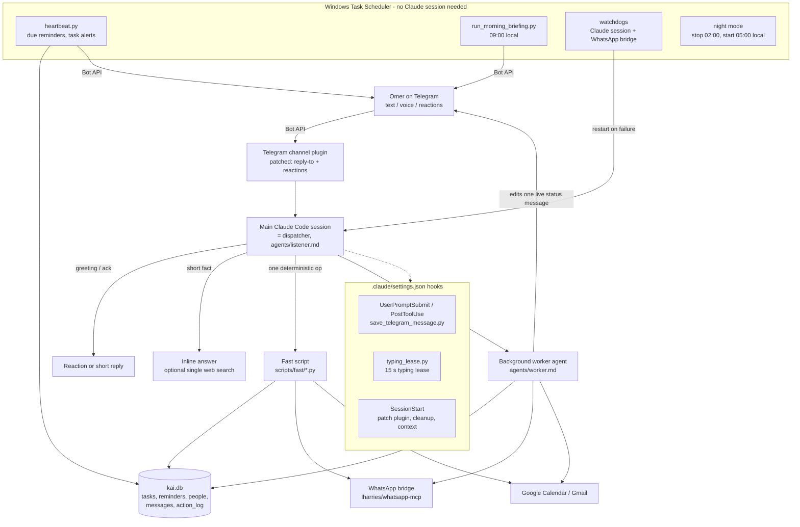

# Architecture

## The message path

1. A Telegram message reaches the main Claude Code session through the Telegram channel plugin.
   `scripts/patch_telegram_plugin.py` patches the plugin so it also forwards reply-to metadata and
   message reactions.
2. Hooks save every incoming and outgoing message to the `messages` table, so Kai has a history the
   Bot API does not provide.
3. The dispatcher (`agents/listener.md`) never does the work itself. One call to
   `scripts/dispatch_start.py` sends a silent status message, checks for a pending question and loads
   the last 20 messages. It then picks the lightest path that does the job:
   - **trivial** (greeting, thanks, "are you there?"): a reaction or a one-line reply, no status
     message;
   - **inline**: a short factual answer, or one web search with a timeout;
   - **fast script**: a deterministic single operation (create a reminder, send a WhatsApp message
     with known text, list calendar events) with no LLM worker;
   - **worker**: everything else. A background agent gets the task and the pre-loaded context, edits
     the one status message before every step, and sends the final answer as a new message.
4. Several messages can be in flight at once; each spawns its own worker.

## Why the pieces look the way they do

- **Status message, not chatter.** Omer reads Kai on a phone. A worker edits a single pinned status
  message while it works and sends exactly one final message.
- **Fast scripts.** A worker costs 30 seconds to 2 minutes; a reminder should take a second.
- **Scheduled jobs outside Claude.** Claude Code cron jobs live only as long as the session and fire
  late. The heartbeat, the morning briefing and the watchdogs run from Windows Task Scheduler and work
  even when the session is down.
- **Hooks own the typing indicator.** Every stuck "typing..." bug came from agents managing the
  indicator by hand (investigation 043). It is now a 15-second lease renewed by tool-call hooks; it
  dies on its own.
- **Principles over rules.** `agents/principles.md` replaced dozens of narrow rules. A correction from
  Omer refines a principle instead of adding a new rule.
- **Rules that matter are enforced in code.** When a prompt-only rule failed twice (TikTok summary
  format, repeated rhetorical words), the check moved into the script.
- **Outward actions need confirmation.** The WhatsApp bridge cannot unsend, so anything sent to other
  people with any ambiguity is drafted first and sent only after a button tap.

## Data model (`schema.sql`)

`tasks` (priority 0-11, domain, due date), `reminders` (recurrence, nag until acknowledged),
`people` and `people_notes` (atomic facts per contact), `messages` (full Telegram history with
reactions), `task_notifications` (de-duplication), `action_log` (audit trail of every agent run).
All times are stored in UTC and converted through `scripts/local_tz.py`.
