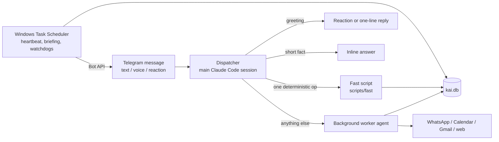

# Kai

**A personal AI assistant that lives in Telegram, built on top of Claude Code, and has run every day since April 2026.**

> Built by Omer as a personal system he uses daily, and published as a portfolio project to show
> agent orchestration, LLM-plus-deterministic-code design, and production-style debugging of a
> long-running AI system.

## The problem

A general chat assistant forgets everything between conversations, cannot act on its own schedule,
and cannot touch the apps a person actually lives in. Omer wanted one assistant he could message in
Hebrew or English, by text or voice, that remembers context, sends reminders until they are handled,
writes WhatsApp messages the way he would, and keeps working when nobody is watching.

## The solution

Kai (קאי) is a long-running **Claude Code** session turned into a dispatcher, plus about 90 Python
scripts, a SQLite data model, Claude Code hooks and Windows Task Scheduler jobs. There is no app
server: every Telegram message is classified and routed to the lightest path that can handle it,
and anything non-trivial runs in a background worker agent while Omer watches a single live status
message.

## Features

- **Telegram in, text or voice.** Voice notes are transcribed with Whisper; Kai answers in the
  language it was written to.
- **Tasks and reminders.** Priorities, due dates and recurrence. A reminder repeats every 5 minutes
  until it is acknowledged, and a 👍 reaction on it marks it done.
- **WhatsApp on Omer's behalf.** Kai writes the message the way Omer would write it to that person.
  Anything ambiguous, or anything going to a group, is drafted first and sent only after a button tap.
- **Google Calendar and Gmail.** Read, create, update and delete events; read mail.
- **Morning briefing at 09:00 local time.** Holidays, weather, calendar, reminders, tasks,
  birthdays and unread mail, sent by a standalone script.
- **Travel mode.** Every clock (reminders, briefing, night mode) follows the local timezone abroad.
- **Extras.** TikTok video summaries in Hebrew, Israel Railways train search, DJ song-pair
  suggestions by BPM and harmonic key.
- **Self-investigation.** When something breaks, Kai writes a root-cause investigation and fixes
  it; 8 of the 43 write-ups are in `investigations/`.
- **Live voice (proof of concept).** A web page with Gemini Live for speech and fast local tools,
  handing heavy requests to Claude (`voice/`).

## How it works

- **Dispatcher / worker split.** The main session never does the work. One call to
  `scripts/dispatch_start.py` sends a silent status message and loads the last 20 messages; then the
  dispatcher picks a path. Workers run in parallel, edit the one status message before every step and
  send exactly one final answer.
- **Fast scripts.** A worker takes 30 seconds to 2 minutes; creating a reminder should take a second.
  About 30 deterministic scripts in `scripts/fast/` skip the LLM worker entirely.
- **Hooks.** Every incoming and outgoing message is saved to SQLite (the Bot API has no history), and
  the typing indicator is a 15-second lease renewed by tool-call hooks, so no agent manages it by hand.
- **Scheduled jobs outside Claude.** The heartbeat (due reminders), the morning briefing, the
  watchdogs and night mode (stop 02:00, start 05:00 local) run from Windows Task Scheduler and work
  even when the Claude session is down.
- **Principles over rules.** `agents/principles.md` holds about 11 behavioural principles and a
  3-question check before every reply; rules that failed twice as prompts are enforced in code.

Full diagram and design reasons: [ARCHITECTURE.md](ARCHITECTURE.md).

## Tech stack

| Layer | Technology |
|-------|------------|
| Agent runtime | Claude Code (sessions, background agents, hooks, MCP, Telegram channel plugin) |
| Code | Python 3, PowerShell and batch for Windows glue |
| Data | SQLite (`schema.sql`), all times in UTC, converted through `scripts/local_tz.py` |
| Messaging | Telegram Bot API; WhatsApp via [lharries/whatsapp-mcp](https://github.com/lharries/whatsapp-mcp) (Go bridge) |
| Google | Calendar and Gmail APIs (OAuth) |
| Speech | Whisper through Groq; Gemini Live for the voice proof of concept (FastAPI server) |
| Scheduling | Windows Task Scheduler |
| Tests | pytest (`tests/`, `voice/test_tools.py`) |

## Project structure

| Path | What it is |
|------|------------|
| `CLAUDE.md` | The project instructions every Kai session loads |
| `agents/listener.md` | The dispatcher: classifies each message and picks a path |
| `agents/worker.md` | Template for background workers and the live status-message protocol |
| `agents/principles.md` | The behavioural principles and the 3-question check |
| `scripts/fast/` | Deterministic single-operation scripts (reminders, tasks, calendar, WhatsApp) |
| `scripts/typing_lease.py` | The typing indicator as a lease renewed by hooks (investigation 043) |
| `scripts/patch_telegram_plugin.py` | Patches the Telegram plugin to expose reply-to and reaction events |
| `scripts/run_morning_briefing.py`, `scripts/heartbeat.py` | Standalone scheduled jobs |
| `scripts/local_tz.py`, `scripts/travel_mode.py` | Local-time handling, including abroad |
| `scripts/tiktok_summary.py` | TikTok video to Hebrew summary (Supadata transcript, Whisper fallback) |
| `scripts/music_pairs/` | DJ-style song-pair suggestions (BPM / Camelot key) |
| `voice/` | Live voice proof of concept (Gemini Live + local tools) |
| `investigations/` | 8 of the 43 root-cause write-ups |
| `docs/` | Setup guide, design docs, plans |
| `schema.sql`, `seed.sql` | The SQLite data model |

## Getting started

Kai is a personal system and was never packaged for reuse: it is Windows-only and paths such as
`D:/Kai` are hard-coded. [docs/kai_setup_guide.md](docs/kai_setup_guide.md) walks through a full
setup. In short:

1. Install Claude Code, Python 3 and Go (for the WhatsApp bridge).
2. Create a Telegram bot with BotFather.
3. Set the environment variables that replace every secret in this public version:

   | Variable | Used for |
   |----------|----------|
   | `KAI_TELEGRAM_BOT_TOKEN` | Telegram Bot API |
   | `KAI_TELEGRAM_CHAT_ID` | The one chat Kai talks to |
   | `GROQ_API_KEY` | Whisper transcription, small LLM calls |
   | `SUPADATA_API_KEY` | TikTok transcripts |
   | `ISRAEL_RAIL_API_KEY` | Train search |

   Google Calendar / Gmail use OAuth files under `credentials/` (client secret + token), created by
   `scripts/fast/fast_cal_auth.py` and `scripts/google_auth_gmail.py`.
4. Create the database: `sqlite3 kai.db < schema.sql` (then `seed.sql`).
5. Clone the WhatsApp bridge (see "Third-party code") and start it with `start_whatsapp_bridge.bat`.
6. Start Kai with `start_claude.bat`.

Placeholders in the code and docs: `${KAI_TELEGRAM_BOT_TOKEN}`, `${KAI_TELEGRAM_CHAT_ID}`,
`<REDACTED_...>` (a secret was removed), and `<partner>`, `<contact>`, `<phone>`, `<email>`,
`<jid>`, `<city>` (personal data was removed from examples).

## What I learned

- **Own each piece of infrastructure in one place.** The typing indicator, restarts and the plugin
  patch all broke while several actors managed them; each now has a single owner.
- **A rule that matters belongs in code.** Prompt-only rules failed twice in the same way before a
  script enforced them.
- **The lightest path wins.** The fast-script and inline paths exist because every second of waiting
  was noticed.
- **Investigate before fixing.** Five plausible root causes for a session that stopped receiving
  messages were all wrong; a controlled experiment found the real one (investigation 038).
- **Outward actions are irreversible.** A WhatsApp message cannot be unsent, so anything ambiguous
  that reaches other people gets a confirmation step.

The full story, month by month, including what broke: [BUILD_STORY.md](BUILD_STORY.md).

## How it was built

Built with AI-assisted development. Omer designed the system, set the requirements, used it daily,
reported every failure and directed every change. Most of the code, prompts and investigation
write-ups were written by Claude Code (Anthropic's agentic coding tool) under his direction; the
`investigations/` files show that loop: a failure, a root-cause analysis, a fix. Claude Code itself
is Anthropic's product and is not part of this repository.

**About the commit history.** It has three kinds of commits, marked so nobody mistakes one for
another:

1. **Real commits (26), 10/04-25/04/2026**: the original commits, with original messages and dates;
   only the files were scrubbed.
2. **Reconstructed commits (14), 11/09-13/10/2026**: nothing was committed after 25/04, so these were
   rebuilt from Claude Code session logs. Each starts with `[reconstructed]`, ends with a
   `Reconstructed-from: Claude Code session log, YYYY-MM-DD` trailer, and carries the original change
   date as author date. The period 26/04-10/09 is a single `[reconstructed] Baseline` commit, some
   logged edits could not be replayed, and intermediate trees are best-effort. Nothing was invented
   to fill a gap.
3. **Snapshot commit (1), 15/10/2026**: makes the tree equal to the scrubbed live system.

From 15/10/2026 on, commits are real and are made at the end of each finished feature or fix. The
full reconstruction details are in [BUILD_STORY.md](BUILD_STORY.md#how-the-commit-history-was-assembled).

**What was removed.** Every commit went through one scrubbing script, kept outside this repository,
and every file version and commit message was scanned afterwards with zero hits. Secrets became
environment variables; the database, `data/`, logs, credentials and the WhatsApp bridge's store are
not in any commit; personal details became placeholders; a few personal-life scripts were left out;
35 of the 43 investigations quote private conversations too closely to scrub and are not included.

## Third-party code

- **WhatsApp bridge:** [lharries/whatsapp-mcp](https://github.com/lharries/whatsapp-mcp) by Luke
  Harries, MIT License. Kai uses it as a local bridge (`whatsapp-mcp/`, not included here). Clone it
  next to the scripts and follow its README.
- **Claude Code** and its Telegram channel plugin: Anthropic.
- **Gemini Live** (voice proof of concept): Google API.
- Python dependencies are listed in the scripts that import them (`requests`,
  `google-api-python-client`, `google-auth-oauthlib`, `fastapi`, `pytest`, and others).

## License

Copyright (c) 2026 Omer. All rights reserved. This code is shared for reading only; no license is
granted to use, copy, modify or distribute it. See [LICENSE](LICENSE).
